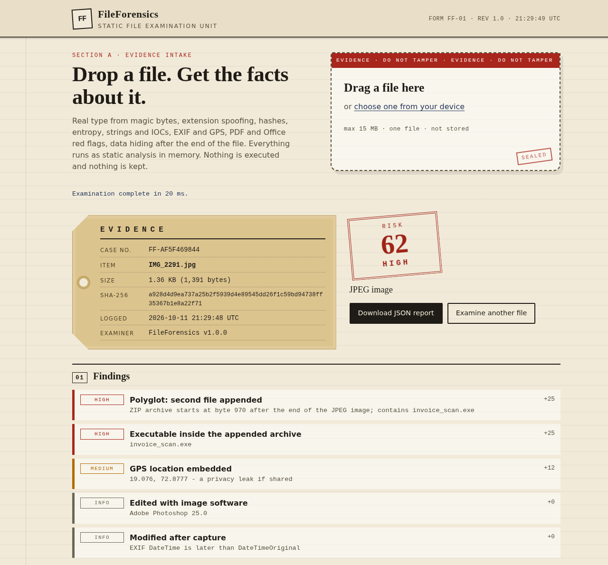
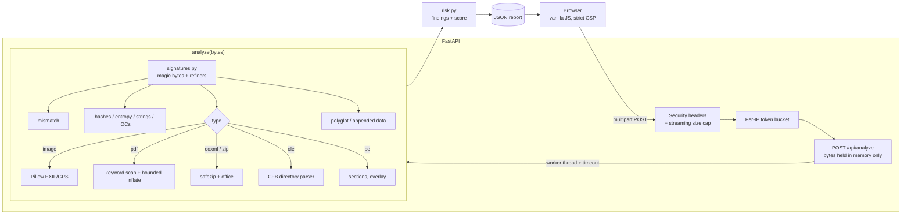

# FileForensics

Drop a file into the page and you get a forensic triage report: what the file really is, whether its name is lying, hashes, entropy, strings and IOCs, EXIF/GPS, PDF and Office red flags, and anything hidden after the end of the file. There's a 0-100 risk score, and every point in it is tied to a finding you can read.

I built this for my Cyber Security & Forensics honours track. I wanted something I'd actually use for a first look at a suspicious attachment, and I wanted to understand file formats at the byte level instead of calling `file` or `exiftool`. The type detection is a signature database I wrote, in pure Python. Nothing is executed and nothing is stored.



*Example above: a photo that still has its GPS tags and has a ZIP containing an `.exe` glued after the JPEG end-of-image marker.*

## What it checks

| Area | What it does |
|---|---|
| **Real file type** | 92 types from magic bytes, including offset-aware signatures (ISO at 32769, tar at 257, PDF anywhere in the first KB). It looks inside containers too: DOCX/XLSX/PPTX vs their macro-enabled versions, ODF, EPUB, JAR, APK, legacy OLE (DOC/XLS/PPT/MSG/MSI, via a small CFB directory parser), EXE vs DLL from the PE header, fat Mach-O vs Java class (both start `CAFEBABE`), WebM vs MKV, and scripts by shebang. |
| **Extension spoofing** | Compares the claimed extension with the detected type, with severity: `invoice.pdf` that's really a PE is critical, `resume.docx` that's actually macro-enabled is high, and `report.docx` saved as `.zip` is just low. It also flags double extensions like `photo.jpg.exe`. |
| **Hashes** | MD5, SHA-1, SHA-256, streamed in 64 KB chunks. |
| **Entropy** | Shannon entropy for the whole file plus per-block values for the chart. Packed/encrypted content is flagged, but not for formats that are compressed by design. |
| **Strings + IOCs** | ASCII and UTF-16LE strings (min length 4, capped). Extracts URLs, IPv4 (public/private), emails, domains, Windows paths, registry keys, and Bitcoin addresses (base58check and bech32 checksums are verified). Network IOCs are defanged. It also flags loader APIs and LOLBin command lines. |
| **Images** | Pillow headers only: camera, lens, software, timestamps, GPS converted to decimal degrees with an OpenStreetMap link, "edited in Photoshop", and "modified after capture". |
| **PDF** | Raw keyword scan for `/JavaScript /JS /OpenAction /AA /Launch /EmbeddedFile /URI /XFA ...`. It decodes `#xx`-obfuscated names, inflates FlateDecode streams under a byte budget (so keywords hidden in object streams still count), counts incremental updates, and reads the Info dictionary and dates. |
| **Office** | `vbaProject.bin`, external relationships (remote template injection, UNC paths that leak NTLM), DDE fields, ActiveX, and embedded objects. Legacy OLE gets macro storages, `Ole10Native` packages, and encrypted packages. |
| **Polyglots** | Walks JPEG/PNG/GIF/PDF/ZIP structure to find the real end of file and identifies what's appended. It scans for PE/ELF/ZIP/RAR/7z/OLE/PDF signatures at non-zero offsets, plus the PE overlay and packer section names. |
| **Report** | Explained findings, a risk score (`critical 45 · high 25 · medium 12 · low 4`, capped at 100), and the full JSON for download. |

## How it fits together



Each analyzer takes `bytes` and returns a plain dict. `app/report.py` runs them, isolates failures (one broken parser can't sink the report), and `app/analyzers/risk.py` turns the dicts into findings.

## Security design (short version)

The full write-up is in [SECURITY.md](SECURITY.md). The main points:

- **Nothing hits disk.** The multipart spool is sized so uploads stay in RAM, and the filename is only ever displayed, never used as a path. A test spies on `tempfile` to prove it.
- **Size is capped while streaming** (15 MB). An oversized `Content-Length` gets a 413 before any body is read, and chunked uploads are cut off at the limit.
- **Zip bombs:** entry-count cap, declared-size cap, ratio check, and overlapping-entry detection. Members are read through a hard byte cap and nothing is extracted. PDF streams are inflated with `max_length`.
- **Pillow** runs with a 64 MP limit and bomb warnings promoted to errors. It never decodes pixels.
- **Time caps** on string extraction and an overall analysis timeout. All structure walkers have loop caps and cycle detection.
- **Rate limit:** in-memory token bucket per IP (20/min, burst 5).
- **Headers:** strict CSP with Trusted Types and no `unsafe-inline`, `nosniff`, `frame-ancestors 'none'`, COOP/CORP, Permissions-Policy, and HSTS when on HTTPS.
- **XSS:** the UI renders file-derived text via `textContent` only, JSON escapes `< > &`, and IOCs are defanged.
- **Errors** are structured JSON with no stack traces.
- **CI:** ruff, pytest (Linux and Windows), bandit, pip-audit, CodeQL. Actions are pinned to SHAs with `contents: read`, and Dependabot is enabled.
- **Docker:** pinned slim base (tag and digest), multi-stage build, non-root, read-only friendly, healthcheck.

## Numbers

All of these come from real runs on my machine (Python 3.12.15, Linux aarch64, 2 CPUs). The test corpus is generated in code by `tests/corpus.py`: crafted headers, Pillow images, stdlib archives, and fake "malicious" markers. No binary samples are in the repo, and there is no real malware.

**Tests:** 413 passing (139 test functions, many parametrized over the corpus). Line + branch coverage of `app/` is **93%**.

**Static checks:** `ruff` clean. `bandit` reports 0 issues across 2,545 lines with no `# nosec`. `pip-audit` finds no known vulnerabilities in runtime or dev requirements.

**Benchmark** (`python scripts/benchmark.py`):

| Check | Result |
|---|---|
| File-type identification | 100/100 samples correct across 14 categories (92 detectable types) |
| Extension spoofing (flag + severity) | 14/14 |
| Polyglot / appended data | 5 TP, 7 TN, 0 FP, 0 FN |
| Risk triage (score ≥ 20 = flagged) | 15 suspicious + 12 benign: 100% recall, 0 false positives |
| Mean analysis time (153-file corpus × 5) | 0.31 ms (median 0.22 ms, p95 0.77 ms) |
| 15 MB high-entropy blob / 15 MB text log | 1,136 ms / 1,440 ms |
| Fuzzing (truncated + bit-flipped corpus) | 5,560 malformed inputs, 0 crashes, 0 analyzer errors |

To be honest about what this measures: the corpus was written alongside the detector, so 100% here means "no regressions on known cases", not "catches 100% of real-world malware". Small crafted files are also why the mean time is so low. The 15 MB rows are the realistic worst case. The fuzzing row is the one I trust most, because those inputs weren't designed to pass.

## Run it locally

You need Python 3.12. There are no system packages (no libmagic, no exiftool), so it works the same on Windows.

**Windows (PowerShell):**

```powershell
python -m venv .venv
.venv\Scripts\Activate.ps1
pip install -r requirements.txt
uvicorn app.main:app --port 8000
```

**macOS / Linux:**

```bash
python3 -m venv .venv
source .venv/bin/activate
pip install -r requirements.txt
uvicorn app.main:app --port 8000
```

Open http://127.0.0.1:8000 and drop a file in.

**Tests, lint, and the benchmark:**

```bash
pip install -r requirements-dev.txt
pytest --cov
ruff check . && ruff format --check .
bandit -c pyproject.toml -r app
pip-audit -r requirements.txt
python scripts/benchmark.py
```

**Docker Desktop:**

```bash
docker build -t fileforensics .
docker run --rm -p 8000:8000 --read-only --tmpfs /tmp:size=16m --cap-drop ALL --security-opt no-new-privileges fileforensics
```

**Configuration** (environment variables, all optional): `FF_MAX_UPLOAD_MB` (15), `FF_RATE_LIMIT_PER_MIN` (20), `FF_RATE_LIMIT_BURST` (5), `FF_ANALYSIS_TIMEOUT` (20 s), `FF_MAX_CONCURRENT` (4), `FF_TRUST_PROXY` (off; set it behind a reverse proxy so `X-Forwarded-For`/`-Proto` are honoured), `FF_FORCE_HSTS` (off).

**API:** `POST /api/analyze` takes multipart with a `file` field. Add `?download=true` to get it as an attachment. There's also `GET /api/health` and `GET /api/limits`.

## Limitations

- It's static analysis, so a clean report is not a verdict. Encrypted archives, password-protected Office files, and novel packers hide their contents.
- The OLE parser only reads the directory. It sees that a `Macros` storage exists, but it doesn't decompress VBA source.
- RAR, 7z, and other non-ZIP archives are identified but not listed.
- PDF parsing is keyword-based, not a full object parser, so very unusual syntax can hide things.
- Rate limiting is in-memory and per process.

## Roadmap

- VBA source extraction from OLE `dir` streams (MS-OVBA decompression)
- YARA rule support (optional, with user-supplied rules)
- Authenticode signature parsing for PE files
- Listing contents of 7z/RAR without extracting
- A CLI (`python -m app.cli file.bin`) that outputs the same JSON

## License

MIT. See [LICENSE](LICENSE). Built by Krrish Bhanushali ([@VRCHAMPION](https://github.com/VRCHAMPION)).
